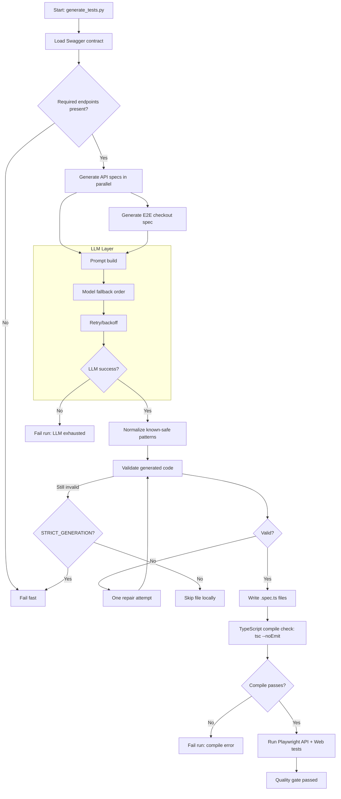
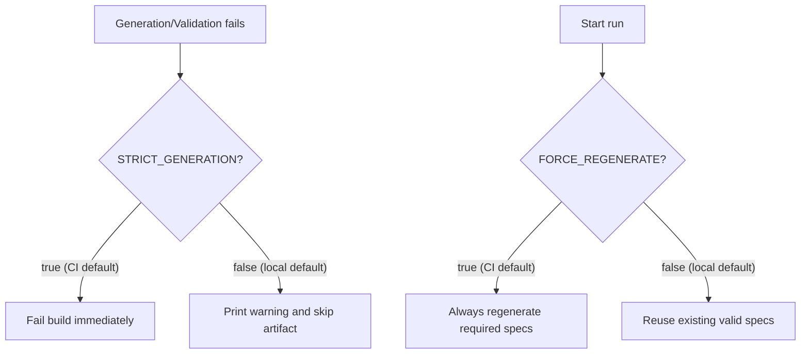

# Playwright-LLM

This repository generates Playwright tests with Google Gemini, validates the generated code, and runs the saved specs in CI as a quality gate.

## Table of Contents

- [Playwright-LLM](#playwright-llm)
  - [Table of Contents](#table-of-contents)
  - [What This Project Does](#what-this-project-does)
  - [Overall Design](#overall-design)
  - [Reliability Layers](#reliability-layers)
  - [Architecture Diagram](#architecture-diagram)
  - [Mode Behavior Diagram](#mode-behavior-diagram)
  - [Design Notes](#design-notes)
    - [1. LLM Prompt Design](#1-llm-prompt-design)
    - [2. Swagger → Playwright Tests](#2-swagger--playwright-tests)
    - [3. Generation Process](#3-generation-process)
    - [4. CI Quality Gate](#4-ci-quality-gate)
    - [5. Scaling to More Endpoints](#5-scaling-to-more-endpoints)
    - [6. Preventing Hallucinated or Incorrect Tests](#6-preventing-hallucinated-or-incorrect-tests)
    - [7. Handling Flaky or Unstable Tests](#7-handling-flaky-or-unstable-tests)
    - [8. E2E Selector Strategy and Stability](#8-e2e-selector-strategy-and-stability)
    - [9. Preventing Flaky Frontend Tests](#9-preventing-flaky-frontend-tests)
  - [Short Script Explanations](#short-script-explanations)
  - [System Under Test](#system-under-test)
  - [Local Use](#local-use)
  - [Docker](#docker)
  - [CI / CD Use](#ci--cd-use)
  - [Validation Rules](#validation-rules)
  - [Caching Strategy](#caching-strategy)
  - [CI / Quality Gate](#ci--quality-gate)
    - [GitHub Actions Setup](#github-actions-setup)
  - [Repository Rules](#repository-rules)
  - [How This Compares To Broader AI Test Generators](#how-this-compares-to-broader-ai-test-generators)
  - [Prompt Files In Use](#prompt-files-in-use)
  - [Why This Is A Good Solution](#why-this-is-a-good-solution)

## What This Project Does

- Generates API tests for `/api/checkout`, `/api/validate-card`, and `/api/validate-email`
- Generates one happy-path E2E checkout test
- Keeps happy-path coverage as the default for both API and web in this assessment
- Supports optional negative/edge-case coverage through a separate prompt flow
- Validates generated output before saving it
- Repairs invalid output once, then skips it if still invalid
- Reuses valid specs and simple cached LLM responses to reduce repeated Gemini calls

## Overall Design

The design is intentionally simple:

1. Load Swagger from a URL or local file
2. Check that the required endpoints exist
3. Use fixed payloads for the required API endpoints
4. Keep API generation contract-first for happy-path scenarios
5. Ask Gemini to generate one API spec per endpoint and one E2E spec
6. Validate the generated code
7. Repair once if needed
8. Save only valid `.spec.ts` files

This keeps the solution deterministic, cheaper to run, and easier to explain.

## Reliability Layers

The architecture is intentionally split into two layers:

1. Core pipeline: load contract, generate specs, validate/repair once, save, execute in CI.
2. Reliability wrappers: model fallback, retry/backoff, strict CI failure mode, compile checks, and safe normalization for recurring mechanical issues.

This keeps the baseline flow easy to understand while still protecting CI from common LLM failure modes.

## Architecture Diagram



## Mode Behavior Diagram



## Design Notes

### 1. LLM Prompt Design

Prompts are split into focused roles. `core_context.txt` sets the global context: TypeScript, Playwright, no placeholders, no TODOs. `api_test_generation.txt` handles API test generation with the Swagger contract and fixed payloads injected via `{{VARIABLE}}` substitution. `e2e_test_generation.txt` handles the checkout flow with explicit selector priority rules. `repair_generation.txt` routes a focused validation message back to Gemini for one fix attempt. `api_test_generation_negative.txt` is a separate prompt reserved for negative/edge-case API tests and is intentionally outside the active happy-path runtime flow. Keeping prompts short and single-purpose reduces unpredictable output.

### 2. Swagger → Playwright Tests

`swagger_loader.py` extracts the method, path, request schema, and response schemas for each required endpoint. `generate_tests.py` combines that contract with fixed deterministic payloads. For API happy-path tests, Swagger contract expectations are authoritative; if backend runtime behavior drifts, generated tests keep contract assertions and fail during Playwright execution. This keeps failures actionable as contract bugs instead of masking them during generation.

### 3. Generation Process

See [Overall Design](#overall-design) and [Short Script Explanations](#short-script-explanations) below.

### 4. CI Quality Gate

See [CI / Quality Gate](#ci--quality-gate) below.

### 5. Scaling to More Endpoints

`generate_tests.py` iterates over a `REQUIRED_ENDPOINTS` list. Adding a new endpoint is one list entry: method, path, payload, and expected status. The rest of the pipeline (prompt rendering, Gemini call, validation, cache, file write) runs automatically for each entry. The caching layer prevents re-generation of previously generated valid specs on partial runs so adding endpoints does not force a full regeneration.

### 6. Preventing Hallucinated or Incorrect Tests

The validator enforces structural correctness (imports, `test()`, `expect()`, no TODOs), then endpoint-specific rules: only the target route can be referenced, the correct HTTP status must be asserted, and at least one stable response field must be asserted. If any check fails, one repair attempt is made with a focused explanation. If the repair still fails, behavior depends on the mode: in CI (`STRICT_GENERATION=true`, the default), the build fails immediately so no required test is silently missing; locally (`STRICT_GENERATION=false`), the file is skipped and a message is printed. Either way, nothing invalid is ever saved. Prompts also embed the Swagger contract directly so Gemini has the source of truth in context rather than guessing field names.

### 7. Handling Flaky or Unstable Tests

Generated API tests are inherently stable because they send fixed payloads to deterministic endpoints. For E2E tests, the prompt explicitly forbids `setTimeout` or manual sleeps and requires Playwright's built-in waiting (`waitForSelector`, `expect(locator).toBeVisible()`). If a test turns flaky in CI, the first step is to check whether the application's response timing changed — not to add retries. Playwright's project-level `retries` config can absorb transient blips without hiding real failures.

### 8. E2E Selector Strategy and Stability

The prompt enforces a strict selector priority:

1. `input[name="..."]` — tied to semantic HTML, survives style changes
2. `getByPlaceholder(...)` — readable and stable for form fields
3. `getByRole(...)` — accessibility-based, framework-independent
4. CSS fallback only when the above are unavailable

`data-testid` attributes are avoided unless confirmed present. `getByLabel` is avoided unless the label text is reliable. This keeps selectors meaningful and resilient to UI refactors.

### 9. Preventing Flaky Frontend Tests

- Assert visible state (`toBeVisible`, `toContainText`) rather than DOM presence alone
- Wait for the success indicator after form submission instead of asserting mid-flight
- Use deterministic fixed inputs — no random data that could trigger different validation paths
- Avoid asserting on network response timing; let the UI state drive assertions
- Keep the E2E test scoped to one happy-path flow so there is minimal shared state between runs

---

## Short Script Explanations

- [`scripts/generate_tests.py`](scripts/generate_tests.py)
   Main orchestration script. It loads Swagger, loops through the required endpoints, applies contract-first QA generation notes, calls Gemini with focused prompts, validates the output, and saves runnable specs.
- [`scripts/swagger_loader.py`](scripts/swagger_loader.py)
  Loads Swagger from a live URL or file path, updates a local fallback copy, and extracts endpoint-specific contract data.
- [`scripts/prompt_loader.py`](scripts/prompt_loader.py)
  Loads prompt templates and replaces variables like `{{ENDPOINT}}` and `{{PAYLOAD}}`.
- [`scripts/llm_client.py`](scripts/llm_client.py)
  Calls Gemini, retries temporary failures like rate limits, and stores simple versioned cache files for repeated runs.
- [`scripts/validator.py`](scripts/validator.py)
   Checks if generated code looks runnable, enforces endpoint-specific API assertions and checkout-flow structure, explains what failed, and performs one repair attempt if needed.

## System Under Test

This repository is the test-generation and quality-gate repo. The application under test runs separately.

Expected environment:

- frontend: `http://localhost:3000`
- backend API: `http://localhost:8080`
- Swagger JSON: `http://localhost:8080/swagger.json`

Required API coverage:

- `POST /api/checkout`
- `POST /api/validate-card`
- `POST /api/validate-email`

Required E2E coverage:

- one happy-path checkout flow

## Local Use

Environment loading behavior:

- Local runs automatically read `.env` when the file exists
- Values already set in your shell take precedence over `.env`
- CI/CD should still use secret stores and pipeline variables

1. Install Python dependencies:
   `pip install -r requirements.txt`
2. Install Node.js dependencies:
   `npm install`
3. Install Playwright browsers:
   `npx playwright install`
4. Set the Gemini API key:
   PowerShell: `$env:GEMINI_API_KEY="your-key"`
5. Start the application under test:
   frontend on `http://localhost:3000`
   backend on `http://localhost:8080`
6. Run the local generator:
   `npm run generate:local`
7. Run the full local gate when needed:
   `npm run quality:gate:local`

You can still call the Python entry point directly:

- `python scripts/generate_tests.py`

You can also pass Swagger explicitly:

- `python scripts/generate_tests.py --swagger ../separate-app/swagger.json`
- `python scripts/generate_tests.py --swagger http://localhost:8080/swagger.json`

Generated API specs are written to `tests/api/` and E2E specs are written to `tests/web/`.

Local defaults:

- existing valid specs are reused
- LLM responses are cached under `.cache/llm/`

## Docker

The included [Dockerfile](Dockerfile) packages the full pipeline — Python, Node.js, Playwright, and Chromium — into a single portable image.

Build the image:

```bash
docker build -t playwright-llm-tests .
```

Run the quality gate, passing your Gemini key and app URLs at run time:

```bash
docker run --rm \
  -e GEMINI_API_KEY=your-key \
  -e STAGING_BASE_URL=http://host.docker.internal:3000 \
  -e STAGING_API_URL=http://host.docker.internal:8080 \
  playwright-llm-tests
```

Use `host.docker.internal` to reach services running on your local machine from inside the container (macOS and Windows). On Linux, use `--network host` and `localhost` as usual.

Playwright reports and test results are written inside the container. Mount a volume to retrieve them:

```bash
docker run --rm \
  -e GEMINI_API_KEY=your-key \
  -e STAGING_BASE_URL=http://host.docker.internal:3000 \
  -e STAGING_API_URL=http://host.docker.internal:8080 \
  -v "$(pwd)/playwright-report:/app/playwright-report" \
  -v "$(pwd)/test-results:/app/test-results" \
  playwright-llm-tests
```

## CI / CD Use

Use the CI-focused generator or quality gate:

- `npm run generate:ci`
- `npm run quality:gate:ci`

CI defaults:

- generation is forced even if valid specs already exist
- generation is strict and fails the job if any required spec cannot be regenerated
- LLM response caching is disabled by default
- `LLM_CACHE_VERSION` can stay on `v1` unless prompt strategy changes
- the workflow should fail fast on generation, compile, or Playwright test errors

Environment controls:

- `FORCE_REGENERATE=true`
- `STRICT_GENERATION=true|false`
- `LLM_MODEL=gemini-2.5-flash,gemini-flash-latest,gemini-flash-lite-latest`
- `LLM_CACHE_ENABLED=true|false`
- `LLM_CACHE_DIR=.cache/llm`

`LLM_MODEL` accepts a comma-separated fallback order. The generator tries models from left to right and automatically switches to the next model when the current model appears quota-limited.

To invalidate old LLM cache entries, bump:

- `LLM_CACHE_VERSION=v1`

In practice, bump `LLM_CACHE_VERSION` whenever prompt wording or validator logic changes. That keeps fresh generations isolated from older cached outputs.

## Validation Rules

A generated test is considered valid when it:

- contains `test()`
- contains `expect()`
- contains imports
- contains no `TODO` or `FIXME`
- references only allowed API routes for API specs
- asserts the expected HTTP status for each required API route
- asserts at least one stable response field for each required API route
- includes the expected checkout structure for E2E specs
- submits the form and asserts a visible success state for E2E specs

If invalid:

- one repair attempt is made with a focused validation message
- if still invalid: in CI (`STRICT_GENERATION=true`) the build fails; locally the file is skipped and a warning is printed

## Caching Strategy

Caching is intentionally simple.

- Each generated artifact gets a readable cache key such as `api_api_checkout` or `e2e_checkout`
- Responses are stored as versioned text files under `.cache/llm/`
- If the prompt strategy changes, bump `LLM_CACHE_VERSION`

This helps reduce unnecessary Gemini calls and lowers the chance of hitting rate limits quickly.

## CI / Quality Gate

The CI pipeline should:

- run test generation
- run Playwright API tests
- run Playwright E2E tests
- fail on any generation or test failure
- publish reports or artifacts

This repo assumes the target application is already running and reachable during CI.

The bundled GitHub Actions workflow now uses the CI-specific quality gate so cache reuse does not hide generation issues.

### GitHub Actions Setup

The bundled workflow expects these GitHub Actions settings:

Secrets:

- `GEMINI_API_KEY`

Repository or environment variables:

- `SWAGGER_PATH`
- `STAGING_BASE_URL`
- `STAGING_API_URL`

Typical values:

```text
GEMINI_API_KEY=your-gemini-key
SWAGGER_PATH=http://localhost:8080/swagger.json
STAGING_BASE_URL=http://localhost:3000
STAGING_API_URL=http://localhost:8080
```

If your CI job talks to a deployed environment instead of local services, point those variables at the deployed frontend, API, and Swagger URL.

If your CI job does not start the application under test, use one of these approaches:

- Start the frontend and backend in the workflow before `npm run quality:gate:ci`
- Point `STAGING_BASE_URL`, `STAGING_API_URL`, and `SWAGGER_PATH` at an already running test environment
- Use a checked-in Swagger file path for `SWAGGER_PATH` if the live Swagger endpoint is not available during generation

## Repository Rules

- Do not modify `playwright.config.ts`
- Do not change the project structure
- Output only runnable `.spec.ts` files
- Do not invent endpoints, fields, or UI selectors
- Use deterministic inputs and stable assertions
- Prefer contract data over model guesses

## How This Compares To Broader AI Test Generators

There are broader AI-assisted testing examples and frameworks that aim to be reusable products. Those tools often focus on natural-language step definitions, richer CLI options, reusable scenario packs, more caching modes, HTML cleanup, reporting, mock execution, or cost analytics.

This repository is intentionally narrower.

- It is built around a fixed assessment scope rather than a generic test-authoring platform
- It uses Swagger and deterministic payloads as the primary grounding mechanism
- It validates generated code before keeping it
- It adds a TypeScript compile gate before Playwright execution
- It treats CI reproducibility and explicit failure behavior as first-class requirements

So compared with broader examples, this project is less feature-rich as a framework, but stronger as a focused, reliability-first generation pipeline. The design choice was deliberate: prioritize determinism, explainability, and quality gating over building a larger AI testing product.

## Prompt Files In Use

- [`prompts/core_context.txt`](prompts/core_context.txt)
- [`prompts/api_test_generation.txt`](prompts/api_test_generation.txt)
- [`prompts/e2e_test_generation.txt`](prompts/e2e_test_generation.txt)
- [`prompts/repair_generation.txt`](prompts/repair_generation.txt)

Negative/edge-case prompt (not active in the current runtime flow):

- [`prompts/api_test_generation_negative.txt`](prompts/api_test_generation_negative.txt)

Other prompt files in [`prompts/`](prompts/) are currently kept as legacy or optional references. They are not loaded by the present runtime flow, so they do not add token cost unless the code is expanded to use them again.

## Why This Is A Good Solution

- It is reproducible
- It is deterministic where possible
- It uses the contract as a source of truth
- It treats generated tests as code that must be validated
- It integrates generation and execution into one quality gate

Fresh-generation proof:

- The repo has been verified with repeated from-scratch generations by deleting generated specs, bumping `LLM_CACHE_VERSION`, regenerating through prompts, and rerunning `npm run quality:gate` successfully.
